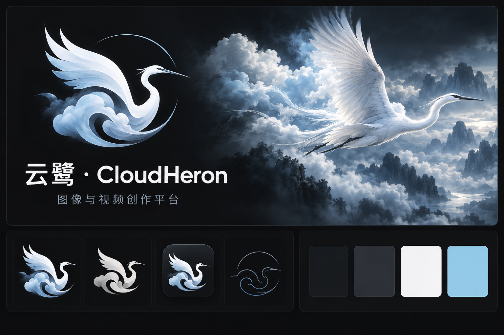

# 云鹭 · CloudHeron 品牌风格说明

文档编号：DOC-DES-005  
版本：v0.3.2  
状态：待评审  
关联：DES-001 / DES-015 / REQ-024 / REQ-030 / REQ-031 / REQ-032

正式名称：云鹭 · CloudHeron。描述：图片与视频创作平台。界面登录、侧栏、页面标题及品牌页均使用已确定名称。

## 品牌风格图

白鹭的长颈与翅膀结合云形，石墨黑背景与雾蓝点缀，保持灰阶界面的克制层次。品牌页保留完整风格板。登录页使用 RAW-009 第一张图清理后的白鹭云海场景作为背景；第二张图提取透明云鹭标志，作为登录、侧栏与浏览器图标。

生成模式：内置 imagegen，新图生成。最终文件：[cloudheron-brand-style.png](../../design/v0.3/assets/cloudheron-brand-style.png)，1536 × 1024。

## 最终生成提示词

Use case: logo-brand. Asset type: a refined brand style board for 云鹭 · CloudHeron, a team AI image and video creation platform. Create one wide landscape brand presentation, about 1536x1024. Exact main title text: “云鹭 · CloudHeron”. Exact smaller descriptor: “图像与视频创作平台”. Elegant white heron with long neck and sweeping wings woven with a soft cloud, original modern emblem, graceful and calm, no cartoon mascot. Dark graphite background #101012, charcoal panel #17171a, off-white #f2f2f4, restrained mist blue #8dcee8. Align with a minimal professional dark software UI: clear hierarchy, generous space, subtle fine borders, rounded 12px shapes. Left prominent cloud-heron symbol and bilingual wordmark. Right a cinematic mist-blue scene of a white heron flying through layered clouds, beautiful atmospheric light and feather detail, integrates subtly with the dark background. Along bottom show small symbol variations and four tasteful color swatches, without extra prose. Crisp Chinese lettering, clean sans serif English, high quality polished brand mood board. No other company names, no watermark, no fabricated UI text, no green or gold accents. This is a brand style illustration, not a website screenshot.

提示词文本另存于 .work/design-v0.3/brand-image-prompt.txt。

## v0.3.1 登录场景与独立图标

登录背景：[cloudheron-login-scene.png](../../design/v0.3/assets/cloudheron-login-scene.png)。由用户第一张图局部编辑，去除残留文字、左侧圆弧和卡片框，保留白鹭与云海场景。

透明图标：[cloudheron-icon.png](../../design/v0.3/assets/cloudheron-icon.png)。从第二张图提取白鹭、云和圆弧，去除背景、标题及右侧场景。真实 RGBA 透明背景，供产品左上角和 favicon 使用。

模式：内置 imagegen，参考图编辑 / 透明背景提取。虚幻悬停效果由页面光雾与视差层实现。

### 场景编辑提示词

Use case: precise-object-edit. Edit target: the attached white heron flying through misty blue cloud sea and Chinese mountain peaks. Make a clean login background scene using exactly this illustration. Remove ALL partial text in the lower left (Heron and Chinese fragment), remove the thin circular logo fragment on the left edge, remove the thin card border and rounded frame. Fill the removed portions naturally with the same dark mist and cloud mountains. Preserve the central flying heron's identity, detailed white feathers, pose, blue-white lighting, mountains, cloud sea and original dramatic atmosphere. Edge-to-edge cinematic scene, no logo, no letters, no words, no palette, no frame. Wide landscape composition, leave the left side subtly darker for separate HTML brand copy; do not redesign the bird or make a vector illustration.

### 图标提取提示词

Use case: background-extraction. Edit target: the attached CloudHeron logo artwork. Extract ONLY the white and mist-blue stylized heron with sweeping upward wing, curved long neck, swirling cloud base and the fine circular blue arc behind it. Preserve this exact symbol and feather/cloud details. Remove all Chinese and English text, all subtitle text, all dark background, all scenic clouds at the right, and all surrounding scene. Place the isolated emblem centered with modest transparent padding in a square canvas, scaled to fill 85 percent of canvas, suitable for a software product icon. Real transparent alpha background, no shadow rectangle, no checkerboard baked into pixels, no new symbols, no extra text.

## v0.3.2 主题适配

登录页切换深浅主题时，品牌区、表单、渐隐层及悬停光雾同步换色。深色底色 #111820，浅色底色 #eef3f7；原场景与独立图标保留。主题差异通过页面样式完成，本轮没有重新生成或修改图像文件。关联 RAW-010 / REQ-026 / REQ-031 / DES-001 / DES-016。
