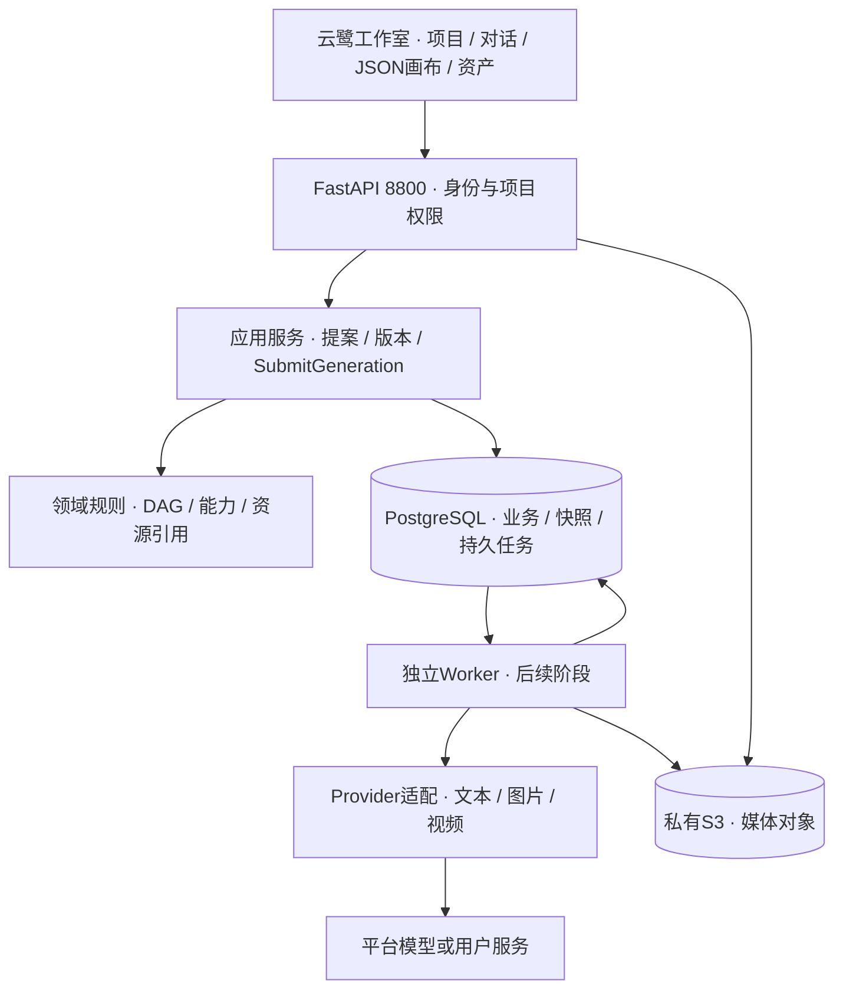

# DOC-DES-014 云鹭 v0.3 总体架构

2026-11-01；设计提案，尚未替换v0.2.2业务实现。RAW-021 → REQ-046/047；DES-035/036/037。依据DOC-REF-001，以下方案是云鹭原创设计决策。

## 定位和范围

云鹭 · CloudHeron：面向团队的图片与视频创作工作室。以项目为中心，包含对话与工作流两类创作入口、统一产物和资产版本。继续保留名称、飞鹭背景、图标和品牌图；不新增分镜剪辑、配音、独立运行记录或一致性检查导航。设定与参考资产帮助复用，不能承诺人物外观百分之百一致。

特色：① 两入口共享项目、上下文及资产；② 对话产物可作为工作流参考，来源能回到原对话或工作流；③ 工作流AI只提案、一次确认保存、显式运行；④ 专家由多个Skill组成；⑤ 团队权限优先于模型工具权限；⑥ 固定版本工作流发布API。以上核心行为沿用已有需求。新“项目创作设定快照”为建议增量，字段范围待设计评审，不自动加入当前用户数据。

## DES-035 模块化单体与共享执行层

建议前端Vue3 + TypeScript + Vite + Vue Flow + Pinia；采用成熟组件的可访问交互，自定义云鹭样式。理由是画布与表单状态可维护、与参考生态匹配；此技术选型尚未安装依赖或完成业务迁移。后端继续FastAPI/Pydantic/psycopg/PostgreSQL JSONB/私有S3；先模块化单体，再拆独立Worker进程，不直接引入多套微服务或第二业务后端。

部署拓扑：浏览器 → 8800同源静态前端/API → 应用服务 → PostgreSQL任务与业务数据、S3媒体、模型适配器。独立Worker经PG领取任务、调用Provider、上传对象、写回结果。前端刷新后从任务状态恢复；未来SSE仅做状态通知，不做执行权威，轮询始终可回退。



```text
frontend/src/
  app/                 路由、主题、会话
  features/projects/   项目、权限、来源入口
  features/chat/       Agent配置、消息、产物
  features/workflows/  Vue Flow视图、JSON编辑、提案、版本
  features/assets/     版本、引用、授权预览
  features/settings/   模型、Skill、专家、团队
  shared/api/          OpenAPI生成类型与请求包装
backend/cloudheron/
  api/                 各领域APIRouter及DTO
  application/         命令、查询、事务边界
  domain/              DAG、资源规则、权限、参数策略
  infrastructure/      PG仓储、S3、凭据、Provider适配
  runtime/             持久队列、领取、心跳、结果提交
  capabilities/        Agent/Skill/专家声明及上下文组装
```

依赖方向api→application→domain；infrastructure实现接口，domain不导入HTTP/SDK。UI组件只发送命令，执行流程不放在Pinia或画布组件里。可执行插件不是现有声明式Skill的默认能力；若将来支持，需独立沙箱与工具白名单设计。

## 统一执行合同

对话提交和工作流run均先校验会话/项目edit/模型能力/输入，事务写入immutable input snapshot、jobs、幂等键。快照包含workflow revision或Agent配置、模型配置版本标识（不含明文key）、Skill/expert展开快照、资产版本ID、可选context revision。Agent和工作流使用相同SubmitGeneration应用服务，区别仅在编译成执行计划的方式。

JSON配置是工作流事实来源，画布只是编辑投影；节点始终是任务。运行状态、产物、预览缓存不能混入可发布定义。保留schema_version=1.0兼容读写；引入新版前提供显式迁移器。节点静态布局字段与语义配置分别比较，拖拽不改变节点执行含义。

AI助手先生成base_revision+提案JSON+差异与摘要；用户取消不写版本；确认接口校验操作者/权限/版本，一次事务保存并消费提案；重复或过期409。确认本身不创建生成任务。

## 数据与权限

保留17张业务表及现有ID。建议增量表：project_context_revisions（project_id,revision,document）、generation_snapshots（job_id,definition,context_revision,redacted_model_snapshot）、asset_links（asset_id,source_type,source_id,job_id）、job_events（job_id,seq,event,time）。唯一键/索引按项目与版本建立；现有JSONB可先承载快照，避免为拆模块先搬表。模型版本设计应引用加密凭据记录，用户导出快照绝不含密钥。

团队角色与项目ACL在每个应用命令及Worker资源读取时校验；资产引用需验证来源和目标项目均有权限。S3对象保持私有，持久保存asset_id，短期签名只用于下载。项目设定对话/工作流共用并明确选择版本，更新不追溯更改已提交任务或已发布API。

沿用当前团队角色，不额外创造第二套身份体系：

| 角色 | 创作及资源 | 模型、用户配置 |
| --- | --- | --- |
| admin 管理员 | 当前团队全量管理 | 管理模型凭据、连接测试与用户 |
| editor 编辑者 | 对拥有或获准编辑资源提交；跨项目引用逐项验证 | 选用已授权能力，不返回明文凭据 |
| viewer 查看者 | 读取可见项目与产物，编辑和生成命令拒绝 | 仅显示可选模型的脱敏描述 |

资源ACL与团队可见性仍按现有规则处理；未来细化权限需另列迁移和测试，不通过前端隐藏按钮代替后端校验。

## Worker演进与可靠性

现状单API单执行器，不通过改Uvicorn workers数假装扩容。DEV-030先将任务生成期间的PG长连接改为短事务；独立Worker阶段再增lease_owner/lease_until/heartbeat/attempt和提交令牌，FOR UPDATE SKIP LOCKED领取。API不再持有旧全局执行锁，Worker新租约上线需单独迁移及回归。过期心跳不意味着可以自动重发付费请求；有上游任务ID则优先查询，无ID或状态不明标为需人工处理。queued可继续，模糊运行态不自动计费重试。提交幂等与外部模型的恰好一次执行是不同保障，UI明确显示重试风险。

## DES-036 前端信息架构

全局：项目、资产、能力库、设置。项目内：概览、对话创作、节点工作流、项目素材、创作设定；执行详情在对话或画布内展开。项目概览按来源区分创作条目，点击进入原历史/画布。默认工作区高对比深石墨，青蓝作为选中状态，保留云鹭影像；浅色使用独立tokens，图片不随主题滤色。

工作流采用画布中心+可折叠节点库+右侧参数/AI/执行抽屉，选中节点才显示其参数。对话采用历史列表+消息/产物+随Agent变化的配置。Agent/Skill/专家表单由能力声明及参数schema驱动，保留已有高级API参数、默认值、范围与附加参数规则；禁止重设计后把现有可选项缩减为固定表单。模型页面把服务协议、文本格式、视频风格分开，连接反馈持续可见。1024px下收起参数为抽屉，移动端优先浏览产物与对话。

## DES-037 渐进替换与验收

阶段A DEV-029：本轮完成原创交互原型和方案，演示数据明确标识，零模型调用。
阶段B DEV-030：后端按领域拆分，保持51路径/63操作契约；OpenAPI差异、权限、幂等、确认规则及旧数据迁移验证通过后再切。
阶段C DEV-031：Vue组件化前端逐页接入，项目→对话→画布→资产/设置，每页保留旧入口回退；schema、用户ID与模型密钥均保留。独立Worker/SSE后置，另测租约中断和结果重复提交。

TST-047评审原型的来源跳转、主题、AI单次确认不执行、JSON导出与参数变化；TST-048覆盖未来新旧接口和数据平行核对。REL-005为待执行发布计划；此设计尚未部署到现有8800。
